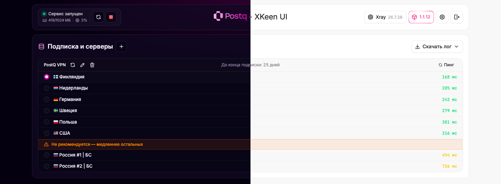

<div align="center">
  

<h1>Postq - XKeen UI</h1>

<p>
  Лёгкая веб-панель для управления <b>XKeen</b> и ядром <b>Xray</b> на роутерах Keenetic и Netcraze
</p>



</div>
<br>

Панель вместе с XKeen ставится на роутер одной командой и работает прямо на нём: подключает подписку
VPN-провайдера, показывает серверы с пингом, сама настраивает маршрутизацию и следит за обновлениями.
Отдельный сервер или компьютер не нужен.

Это форк [zxc-rv/XKeen-UI](https://github.com/zxc-rv/XKeen-UI), заточенный под Xray и подписки с учётом устройств
(Remnawave и похожие панели провайдеров).

&nbsp;

## ✨ Возможности

**Подписка и серверы — главная страница**

- При первом входе достаточно вставить ссылку `https://` от провайдера: панель загрузит подписку, возьмёт её
  название у провайдера, включит маршрутизацию, запустит XKeen и предложит выбрать сервер
- Серверы подписки обновляются по расписанию, имена — как у провайдера, с флагами стран
- Выбор сервера в один клик
- Честный пинг: реальный запрос через каждый сервер (как URL-тест в v2rayN/Clash), проверяет, что VPN действительно работает, включая Hysteria2
- Российские серверы — в конце списка под плашкой «Не рекомендуется»; серверы авто-выбора и строки-разделители провайдера скрыты
- Сколько дней осталось до конца подписки; за 5 дней и меньше — оранжевый значок и напоминание продлить
- Обновление, изменение и удаление подписки — кнопками рядом с её названием, «+» у заголовка добавляет новую
- Обязательный `x-hwid` и данные устройства (`x-device-os: Router`, модель и версия ОС роутера) для панелей с лимитом устройств

**Маршрутизация**

- Готовая маршрутизация ставится сама после добавления первой подписки; прежний `05_routing.json` сохраняется рядом как `.bak`
- Если на роутере нет нужных геобаз, панель покажет красное предупреждение с кнопкой «Скачать геобазы и включить
  автообновление» — после загрузки маршрутизация включится сама, а геобазы будут обновляться раз в сутки

**Логи**

- Логи Xray настроены панелью: `access.log` и `error.log` в `/opt/var/log/xray/`, уровень warning, DNS-лог включён
- Размер ограничен: файл больше 10 МБ обрезается до последних 5 МБ, накопитель не переполнится
- «Скачать лог» на главной — `error.log` или `access.log` одним нажатием

**Управление**

- Запуск, остановка и перезапуск XKeen, загрузка процессора и памяти роутера
- Обновление ядра Xray и самой панели; о новой версии панель сообщает рамкой на кнопке версии (проверка раз в час)
- После установки или обновления панель открывается на главной странице
- Вход по паролю; в настройках — тема (светлая, тёмная, как в системе), смена пароля и часовой пояс журнала

&nbsp;

## ⚡️ Установка с нуля

Понадобится роутер Keenetic или Netcraze, USB-накопитель и компьютер в той же сети. Если Entware на роутере
уже стоит, переходите сразу к [шагу 5](#5-установите-xkeen-и-панель).

### 1. Подготовьте USB-накопитель

Entware и XKeen живут на USB-накопителе. Подойдёт флешка от 1 ГБ. Отформатируйте её на компьютере
в файловую систему **EXT4** (все данные на ней будут удалены).

### 2. Установите компоненты прошивки

В веб-интерфейсе роутера откройте «Общие настройки» → «Изменить набор компонентов» и отметьте:

- **Поддержка открытых пакетов**
- **Файловая система Ext**
- **Модули ядра подсистемы Netfilter**

Нажмите «Установить обновление». Роутер скачает компоненты и перезагрузится.

### 3. Установите Entware

1. Узнайте архитектуру роутера по [списку моделей](https://github.com/jameszeroX/XKeen/wiki/Routers-Info) и скачайте установщик:

   | Архитектура | Установщик |
   | --- | --- |
   | `aarch64` | [aarch64-installer.tar.gz](https://bin.entware.net/aarch64-k3.10/installer/aarch64-installer.tar.gz) |
   | `mipsel` | [mipsel-installer.tar.gz](https://bin.entware.net/mipselsf-k3.4/installer/mipsel-installer.tar.gz) |
   | `mips` | [mips-installer.tar.gz](https://bin.entware.net/mipssf-k3.4/installer/mips-installer.tar.gz) |

2. Вставьте накопитель в роутер. Откройте его с компьютера по сети (сетевая папка роутера или FTP),
   создайте в корне папку `install` и положите в неё скачанный файл, не распаковывая.
3. В веб-интерфейсе откройте раздел **OPKG** («Управление» → «OPKG»), выберите накопитель и сохраните.
   Установка займёт несколько минут; в системном журнале появится сообщение о её завершении.

Подробная инструкция с картинками — у [Keenetic](https://help.keenetic.com/hc/ru/articles/360021214160)
и [Netcraze](https://support.netcraze.ru/giga/nc-1012/ru/20980-installing-the-entware-repository-on-a-usb-drive.html).

### 4. Подключитесь к роутеру по SSH

Откройте терминал на компьютере (PowerShell в Windows, «Терминал» в macOS и Linux) и подключитесь к Entware:

```sh
ssh root@192.168.1.1 -p 222
```

Пароль по умолчанию — `keenetic`. Сразу смените его командой `passwd`. Затем поставьте нужные утилиты:

```sh
opkg update && opkg install curl tar
```

Если `opkg update` не может скачать пакеты, переключите Entware на зеркало и повторите команду:

```sh
sed -i 's,http://bin.entware.net/,http://mirrors.nju.edu.cn/entware/,g' /opt/etc/opkg.conf
```

### 5. Установите XKeen и панель

```sh
curl -L https://raw.githubusercontent.com/postq-vpn/XKeenPQ-UI/main/setup.sh | sh -s -- auto
```

Команда ставит всё без вопросов:

- [XKeen](https://github.com/jameszeroX/XKeen) с ядром Xray, геобазами, списками российских IP-адресов
  (они идут напрямую, мимо прокси), их еженедельным автообновлением и автозагрузкой;
- панель XKeenPQ-UI.

Установка занимает несколько минут — XKeen скачивает ядро и геобазы с GitHub.

На **KeeneticOS 5.2 и новее** XKeen нужен токен доступа к роутеру — команда получает его сама.
Если это не удалось, она объяснит, где создать токен (веб-интерфейс → «Пользователи и доступ» → «Токены доступа»),
и попросит вставить его прямо в терминале. Токен можно передать и сразу в команде:

```sh
curl -L https://raw.githubusercontent.com/postq-vpn/XKeenPQ-UI/main/setup.sh | sh -s -- auto token=ВАШ_ТОКЕН
```

### 6. Подключите подписку

Откройте в браузере **`http://192.168.1.1:1000`** (адрес выводится в конце установки), задайте пароль
и вставьте ссылку на подписку от провайдера. Панель загрузит серверы, включит маршрутизацию и запустит XKeen —
остаётся выбрать сервер.

&nbsp;

## 🔄 Обновление

Панель сама сообщает о новой версии рамкой на кнопке версии и обновляется из интерфейса.
Обновить её можно и той же командой, что ставит её:

```sh
curl -L https://raw.githubusercontent.com/postq-vpn/XKeenPQ-UI/main/setup.sh | sh -s -- auto
```

- XKeen и ядро Xray уже установлены — команда их не трогает и обновляет только панель.
- Если стоит старый XKeen 1.x, команда заменит его актуальной версией: сохранит копию конфигов Xray
  в `/opt/backups`, остановит старый XKeen, поставит новый поверх и запустит прокси. Конфиги Xray,
  списки XKeen и настройки автозапуска остаются; если замена не удалась, старый XKeen запустится снова.
- Порт, пароль, подписки и выбранный сервер сохраняются.
- Если стоит оригинальная [XKeen-UI](https://github.com/zxc-rv/XKeen-UI), команда заменит её этой панелью с сохранением пароля и настроек.
- Если XKeen работал на ядре Mihomo, команда поставит Xray, переключит XKeen на него и запустит прокси.

Бета-версия ставится с параметром `beta`:

```sh
curl -L https://raw.githubusercontent.com/postq-vpn/XKeenPQ-UI/main/setup.sh | sh -s -- auto beta
```

<details>
<summary><b>Меню установщика: только панель, без XKeen</b></summary>
<br>

Без `auto` скрипт показывает меню и работает только с панелью:

```sh
curl -L https://raw.githubusercontent.com/postq-vpn/XKeenPQ-UI/main/setup.sh | sh
```

| Пункт | Что делает |
| --- | --- |
| `1` Установить/переустановить | Ставит панель с нуля, старая версия удаляется |
| `2` Обновить | Обновляет панель, порт и настройки сохраняются |
| `3` Удалить | Удаляет панель и её файлы, XKeen и конфиги Xray остаются |

</details>

<details>
<summary><b>Ручная установка, если скрипт не скачивает панель</b></summary>
<br>

1. Узнайте архитектуру роутера: `opkg print-architecture` (`aarch64` → `arm64-v8a`, `mipsel` → `mips32le`, `mips` → `mips32`).
2. Скачайте файл `xkeen-ui-<архитектура>` со страницы [релизов](https://github.com/postq-vpn/XKeenPQ-UI/releases/latest).
3. Положите его на роутер в `/opt/tmp/` (например, через SFTP).
4. Запустите скрипт без `auto` и выберите пункт `1`: он подхватит файл из `/opt/tmp/`.

</details>

&nbsp;

## 🎛️ Команды на роутере

| Команда | Действие |
| --- | --- |
| `xkeen-ui start` / `stop` / `restart` / `status` | Управление сервисом панели |
| `xkeen-ui reset-password` | Сбросить пароль, после этого задать новый при входе |
| `xkeen-ui setup` | Запустить установочный скрипт |
| `xkeen-ui -v` | Версия панели и модель роутера |

Порт по умолчанию — `1000`. Поменять его можно в `/opt/etc/init.d/S99xkeen-ui` (строка `ARGS="-p 1000"`),
затем выполнить `xkeen-ui restart`.

Лог панели: `/opt/var/log/xkeen-ui.log`.

&nbsp;

## 🌐 Доступ извне

Панель рассчитана на работу в локальной сети. Для доступа издалека используйте VPN до роутера (WireGuard, SSTP и т.п.).
Можно открыть её и через KeenDNS: создайте поддомен с протоколом HTTP и портом панели, обязательно включив пароль.

> [!CAUTION]
> Открытая в интернет панель без пароля даёт полный доступ к настройкам прокси на роутере.

&nbsp;

## 🙏 Благодарности

- [zxc-rv/XKeen-UI](https://github.com/zxc-rv/XKeen-UI) — оригинальная панель, на которой основан форк
- [jameszeroX/XKeen](https://github.com/jameszeroX/XKeen) и [Skrill0/XKeen](https://github.com/Skrill0/XKeen) — XKeen
- [XTLS/Xray-core](https://github.com/XTLS/Xray-core) — ядро Xray
- [Entware](https://github.com/Entware/Entware) — пакетный менеджер для роутеров

&nbsp;

## 📄 Лицензия

[MIT](LICENSE)
