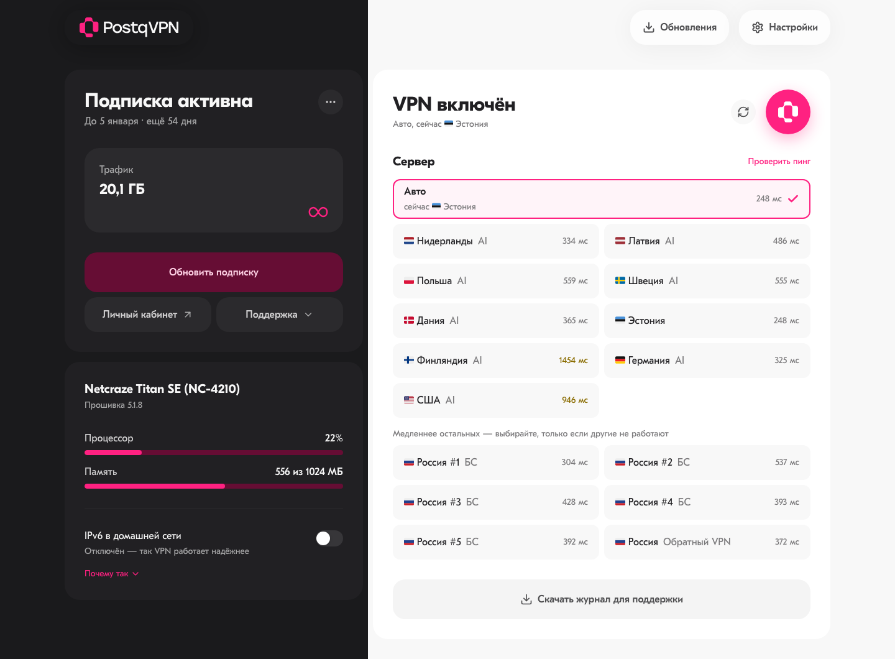

<div align="center">
  

<h1>PostqVPN — XKeen UI</h1>

<p>
  Веб-панель, которая подключает VPN-подписку прямо на роутере <b>Keenetic</b> или <b>Netcraze</b>
</p>



</div>
<br>

Панель ставится на роутер одной командой и работает прямо на нём. После установки VPN получают все устройства
домашней сети — телефоны, компьютеры, телевизоры, приставки — без отдельных приложений на каждом.

Внутри работают [XKeen](https://github.com/jameszeroX/XKeen) и ядро [Xray](https://github.com/XTLS/Xray-core),
а панель берёт на себя всё, что раньше приходилось настраивать руками: подписку, серверы, маршрутизацию
и обновления. Отдельный сервер или компьютер не нужен.

Это форк [zxc-rv/XKeen-UI](https://github.com/zxc-rv/XKeen-UI), заточенный под Xray и подписки с учётом устройств
(Remnawave и похожие панели провайдеров).

&nbsp;

## 📋 Что понадобится

- Роутер **Keenetic** или **Netcraze** с USB-портом (архитектуры `aarch64`, `mipsel`, `mips`)
- USB-накопитель от 1 ГБ
- Подписка VPN-провайдера — ссылка вида `https://…`
- Компьютер в той же сети на время установки

&nbsp;

## ✨ Возможности

### Подписка и серверы

- **Подключение одной ссылкой.** При первом входе панель сама предложит вставить ссылку на подписку: загрузит
  серверы, возьмёт название у провайдера, включит маршрутизацию и запустит VPN в режиме «Авто»
- **Серверы с флагами стран** и именами как у провайдера; список обновляется сам по расписанию
  (по умолчанию раз в 12 часов)
- **Режим «Авто»**: Xray сам выбирает самый быстрый рабочий зарубежный сервер, панель показывает текущий сервер и его пинг
- **Выбор конкретного сервера в один клик.** Раз в минуту панель проверяет его реальным запросом. Если он не отвечает
  две проверки подряд, а другие серверы подписки работают, подписка переходит в режим «Авто», Xray при этом
  перезапускается. Обратно панель не возвращается: сервер снова выбираете вы
- **Честный пинг**: реальный запрос через каждый сервер, а не просто проверка порта — видно, что VPN действительно
  работает (включая Hysteria2)
- **Российские серверы — в конце списка** под плашкой «Не рекомендуется»
- **Срок подписки**: сколько дней осталось; за 5 дней и меньше — оранжевый значок и напоминание продлить
- **Управление подпиской** кнопками рядом с её названием: обновить, изменить, удалить; «+» у заголовка добавляет новую
- **Поддержка лимита устройств**: панель передаёт провайдеру постоянный идентификатор роутера (`x-hwid`),
  модель и версию прошивки: подписки с ограничением по устройствам работают, а роутер всегда считается одним устройством

### Маршрутизация

Готовые правила ставятся сами после добавления первой подписки — разбираться в конфигах Xray не нужно.
Прежний `05_routing.json` сохраняется рядом как `.bak`.

| Куда | Что |
| --- | --- |
| Через VPN | Сайты и сервисы из списков [zkeen](https://github.com/jameszeroX/zkeen-domains), например YouTube; TikTok, Claude; адреса крупных CDN и хостингов из [zkeen-ip](https://github.com/jameszeroX/zkeen-ip), например Cloudflare и Amazon |
| Напрямую | Российские сайты и сервисы, китайские сервисы, Steam, Rockstar, торренты, обычный HTTP (TCP 80) и весь остальной трафик, не попавший в правила выше |
| Блокируется | QUIC (UDP 443) — приложения сразу переходят на обычный TCP, который стабильнее работает через VPN |

### Управление и обслуживание

- **Статус VPN** в шапке: запуск, остановка и перезапуск, загрузка процессора и памяти роутера
- **Обновления в один клик** — и самой панели, и ядра Xray; о новой версии панель сообщает рамкой на кнопке
  версии (панель проверяется раз в час, Xray — раз в 4 часа). Устанавливаются обновления только по вашей команде
- **«Скачать лог»** на главной — оба журнала Xray одним zip-архивом, удобно отправить в поддержку. В журналах есть
  адреса сайтов и устройства сети, поэтому перед отправкой решите, кому их можно показывать
- **Логи не переполнят накопитель**: файл больше 10 МБ обрезается до последних 5 МБ
- **Вход по паролю** — по умолчанию выключен, включается в настройках; там же светлая, тёмная или системная тема,
  сброс пароля и часовой пояс журнала
- **Защита от сбоев**:
  - настройки и подписки записываются на накопитель так, чтобы обрыв питания не оставил пустой файл;
  - повреждённый файл настроек сохраняется как `xkeen-ui.json.corrupt`, а панель запрашивает новый пароль
    и возвращает настройки по умолчанию;
  - повреждённый файл подписок не перезаписывается, панель сообщает об ошибке;
  - перед перезапуском Xray после изменения подписки конфигурация проверяется: с плохой работающий Xray не останавливается

&nbsp;

## ⚡️ Установка с нуля

Шесть шагов от «чистого» роутера до работающего VPN. Если Entware на роутере
уже стоит, переходите сразу к [шагу 5](#5-установите-xkeen-и-панель).

### 1. Подготовьте USB-накопитель

Entware и XKeen живут на USB-накопителе. Подойдёт флешка от 1 ГБ. Отформатируйте её на компьютере
в файловую систему **EXT4** (все данные на ней будут удалены).

### 2. Установите компоненты прошивки

В веб-интерфейсе роутера откройте «Общие настройки» → «Изменить набор компонентов» и отметьте:

- **Поддержка открытых пакетов**
- **Файловая система Ext**
- **Модули ядра подсистемы Netfilter**

Нажмите «Установить обновление». Роутер скачает компоненты и перезагрузится.

### 3. Установите Entware

1. Узнайте архитектуру роутера по [списку моделей](https://github.com/jameszeroX/XKeen/wiki/Routers-Info) и скачайте установщик:

   | Архитектура | Установщик |
   | --- | --- |
   | `aarch64` | [aarch64-installer.tar.gz](https://bin.entware.net/aarch64-k3.10/installer/aarch64-installer.tar.gz) |
   | `mipsel` | [mipsel-installer.tar.gz](https://bin.entware.net/mipselsf-k3.4/installer/mipsel-installer.tar.gz) |
   | `mips` | [mips-installer.tar.gz](https://bin.entware.net/mipssf-k3.4/installer/mips-installer.tar.gz) |

2. Вставьте накопитель в роутер. Откройте его с компьютера по сети (сетевая папка роутера или FTP),
   создайте в корне папку `install` и положите в неё скачанный файл, не распаковывая.
3. В веб-интерфейсе откройте раздел **OPKG** («Управление» → «OPKG»), выберите накопитель и сохраните.
   Установка займёт несколько минут; в системном журнале появится сообщение о её завершении.

Подробная инструкция с картинками — у [Keenetic](https://help.keenetic.com/hc/ru/articles/360021214160)
и [Netcraze](https://support.netcraze.ru/giga/nc-1012/ru/20980-installing-the-entware-repository-on-a-usb-drive.html).

### 4. Подключитесь к роутеру по SSH

Откройте терминал на компьютере (PowerShell в Windows, «Терминал» в macOS и Linux) и подключитесь к Entware:

```sh
ssh root@192.168.1.1 -p 222
```

Пароль по умолчанию — `keenetic`. Сразу смените его командой `passwd`. Затем поставьте нужные утилиты:

```sh
opkg update && opkg install curl tar
```

Если `opkg update` не может скачать пакеты, переключите Entware на зеркало и повторите команду:

```sh
sed -i 's,http://bin.entware.net/,http://mirrors.nju.edu.cn/entware/,g' /opt/etc/opkg.conf
```

### 5. Установите XKeen и панель

```sh
curl -L https://raw.githubusercontent.com/postq-vpn/XKeenPQ-UI/main/setup.sh | sh -s -- auto
```

Команда сама смотрит, что уже стоит на роутере, и делает только нужное — без вопросов:

| На роутере | Что сделает команда |
| --- | --- |
| Ничего, кроме Entware | Поставит [XKeen](https://github.com/jameszeroX/XKeen) и панель |
| Актуальный XKeen | Оставит XKeen как есть, поставит или обновит панель |
| Старый XKeen 1.x | Заменит его актуальной версией, затем поставит панель |
| XKeen на ядре Mihomo | Поставит Xray, переключит XKeen на него и запустит прокси |
| Оригинальная [XKeen-UI](https://github.com/zxc-rv/XKeen-UI) | Заменит её этой панелью, пароль и настройки сохранятся |

XKeen ставится с ядром Xray, геобазами, списками российских IP-адресов (они идут напрямую, мимо прокси),
их еженедельным автообновлением и автозагрузкой. Установка занимает несколько минут — XKeen скачивает
ядро и геобазы с GitHub.

<details>
<summary><b>Как заменяется старый XKeen 1.x</b></summary>
<br>

1. Конфиги Xray копируются в `/opt/backups/xray-configs-<дата>`.
2. Скачивается установщик актуального XKeen. Если он не скачался, старый XKeen продолжает работать как раньше.
3. Старый XKeen останавливается, новый ставится поверх: конфиги Xray и списки XKeen остаются,
   порты и политика переносятся в новый файл автозапуска.
4. Прокси запускается снова, если работал до замены.

Если установка сорвалась, старый XKeen запускается снова, а копия конфигов остаётся в `/opt/backups`.

</details>

#### Токен доступа (KeeneticOS 5.2 и новее)

С прошивки 5.2 XKeen и панель работают с роутером только по токену доступа. Команда получает его сама
и сохраняет в `/opt/etc/xkeen/xkeen.json`. На прошивках до 5.2 токен не нужен, этот шаг пропускается.

Если получить токен автоматически не удалось, команда остановится до начала установки и попросит
создать его вручную:

```
 Нужен токен доступа к роутеру

 На KeeneticOS 5.2 и новее XKeen и панель работают с роутером только по токену доступа.
 Получить его автоматически не удалось, создайте токен вручную:

   1. Откройте веб-интерфейс роутера: http://192.168.1.1
   2. Раздел «Пользователи и доступ» → «Токены доступа» → «Добавить токен»
   3. Скопируйте токен и вставьте его ниже

 Чтобы прервать установку, нажмите Ctrl+C

 Токен:
```

Вставьте токен и нажмите Enter — команда проверит его и продолжит установку. Если роутер его не принял,
она попросит токен ещё раз; пустой Enter ничего не делает, выйти из установки можно только по **Ctrl+C**.

Токен можно передать и сразу в команде — пригодится, если терминал не интерактивный (например, `ssh` без `-t`):

```sh
curl -L https://raw.githubusercontent.com/postq-vpn/XKeenPQ-UI/main/setup.sh | sh -s -- auto token=ВАШ_ТОКЕН
```

### 6. Подключите подписку

Откройте в браузере **`http://192.168.1.1:1000`** (адрес выводится в конце установки) и вставьте ссылку
на подписку от провайдера. Панель загрузит серверы, включит маршрутизацию и запустит XKeen в режиме «Авто» —
при желании можно выбрать конкретный сервер.

> [!IMPORTANT]
> Сразу после установки панель открывается без пароля. Включите его в настройках («Авторизация»):
> иначе любое устройство в вашей сети сможет управлять панелью.

&nbsp;

## 🔄 Обновление

Панель сама сообщает о новой версии рамкой на кнопке версии и обновляется из интерфейса.
Обновить её можно и той же командой, что ставит её, — она работает как [при установке](#5-установите-xkeen-и-панель):

```sh
curl -L https://raw.githubusercontent.com/postq-vpn/XKeenPQ-UI/main/setup.sh | sh -s -- auto
```

Актуальный XKeen и ядро Xray команда не трогает и обновляет только панель. Порт, пароль, подписки
и выбранный сервер сохраняются.

Бета-версия ставится с параметром `beta`:

```sh
curl -L https://raw.githubusercontent.com/postq-vpn/XKeenPQ-UI/main/setup.sh | sh -s -- auto beta
```

<details>
<summary><b>Меню установщика: только панель, без XKeen</b></summary>
<br>

Без `auto` скрипт показывает меню и работает только с панелью:

```sh
curl -L https://raw.githubusercontent.com/postq-vpn/XKeenPQ-UI/main/setup.sh | sh
```

| Пункт | Что делает |
| --- | --- |
| `1` Установить/переустановить | Ставит панель с нуля, старая версия удаляется |
| `2` Обновить | Обновляет панель, порт и настройки сохраняются |
| `3` Удалить | Удаляет программу панели и её скрипт запуска. Остаются XKeen, конфиги Xray, настройки и подписки панели в `/opt/etc/xkeen`, журналы, бэкапы и токен доступа к роутеру |

</details>

<details>
<summary><b>Ручная установка, если скрипт не скачивает панель</b></summary>
<br>

1. Узнайте архитектуру роутера: `opkg print-architecture` (`aarch64` → `arm64-v8a`, `mipsel` → `mips32le`, `mips` → `mips32`).
2. Скачайте файл `xkeen-ui-<архитектура>` со страницы [релизов](https://github.com/postq-vpn/XKeenPQ-UI/releases/latest).
3. Положите его на роутер в `/opt/tmp/` (например, через SFTP).
4. Запустите скрипт без `auto` и выберите пункт `1`: он подхватит файл из `/opt/tmp/`.

</details>

&nbsp;

## 🎛️ Команды на роутере

| Команда | Действие |
| --- | --- |
| `xkeen-ui start` / `stop` / `restart` / `status` | Управление сервисом панели |
| `xkeen-ui reset-password` | Сбросить пароль, после этого задать новый при входе |
| `xkeen-ui setup` | Запустить установочный скрипт |
| `xkeen-ui -v` | Версия панели и модель роутера |

Порт по умолчанию — `1000`. Поменять его можно в `/opt/etc/init.d/S99xkeen-ui` (строка `ARGS="-p 1000"`),
затем выполнить `xkeen-ui restart`.

Лог панели: `/opt/var/log/xkeen-ui.log`.

&nbsp;

## 🌐 Доступ не из локальной сети

Самый безопасный способ зайти издалека — VPN до роутера (WireGuard, SSTP и т.п.). Панель работает с правами `root`,
поэтому вход в неё равен полному доступу к роутеру.

> [!WARNING]
> **Открывать панель через CrazeDNS или KeenDNS не рекомендуется.** Вы делаете это на свой риск: авторы панели не несут
> ответственности за возможные последствия, включая взлом роутера и потерю данных.

Если всё же открываете, то только с паролем:

1. Обновите панель. Из локальной сети включите в настройках авторизацию и задайте длинный уникальный пароль: не менее
   8 символов, лучше 16 и больше.
2. В настройках доменного имени роутера укажите панель как этот роутер, порт `1000` и входите только по HTTPS.
   Проброс порта `1000` напрямую не используйте: панель работает по HTTP, пароль пойдёт без шифрования.

Панель считает запрос локальным, только если он пришёл с частного адреса, без заголовков прокси и по локальному адресу:
IP роутера, `my.keenetic.net`, `my.netcraze.net`, имя без точек или с окончанием `.local`. Остальные запросы считаются
внешними:

- Без включённого пароля панель внешние запросы отклоняет
- Задать или сбросить пароль, включить или выключить авторизацию, а также сменить репозиторий Xray и зеркала GitHub
  можно только из локальной сети
- На внешние запросы действует один общий лимит: 5 неверных паролей в минуту. Подбор пароля из интернета может временно
  заблокировать вход извне, но из локальной сети войти можно всегда

Пути конфигов (`append_config_paths`) и данные пароля через API не меняются, только в файле настроек на роутере.

&nbsp;

## 🔍 Что панель делает на роутере и в сети

Телеметрии и аналитики в панели нет. Весь внешний обмен данными — ниже.

### Что и куда передаётся

| Куда | Что и когда |
| --- | --- |
| Ваш провайдер подписки | Запрос подписки при добавлении и по расписанию: постоянный идентификатор роутера `x-hwid` (хеш серийного номера или MAC-адреса), модель роутера, версия прошивки и платформа `Router` |
| `www.gstatic.com` | Проверка пинга, режим «Авто» и ежеминутная проверка выбранного сервера: запросы идут через ваши VPN-серверы |
| `api.github.com`, `github.com` | Проверка и загрузка обновлений панели и Xray, геобазы. Браузер тоже обращается к `api.github.com`, когда открывается окно обновления |
| `gh-proxy.com`, `ghfast.top` | Сторонние зеркала: панель обращается к ним, если GitHub недоступен. Через них можно получить и файлы обновлений |
| `data.jsdelivr.com` | Запасной список версий, если браузер не смог получить его с GitHub |
| `1.1.1.1`, `8.8.8.8` | DNS-over-HTTPS, только когда вы вручную проверяете домен по геобазам: имя домена уходит Cloudflare или Google |
| `raw.githubusercontent.com` | Установочный скрипт; каталог шаблонов конфигов, если вы его открываете |
| `postq.space` | Только если вы нажмёте на логотип |

Обновления не проверяются цифровой подписью. Для самой панели проверяется только то, что файл похож на программу
для Linux, для Xray такой проверки нет. Затем файл запускается от `root`, поэтому вы доверяете GitHub,
этому репозиторию и зеркалам.

### Что меняется на роутере

- **Токен доступа.** На KeeneticOS 5.2 и новее установщик сам выпускает токен с правами `admin` и сохраняет его
  в `/opt/etc/xkeen/xkeen.json`. Он бессрочный и при удалении панели не отзывается. Удалить его можно в разделе
  «Пользователи и доступ» → «Токены доступа» веб-интерфейса роутера, но без токена XKeen на этих прошивках работать не сможет
- **XKeen.** Установщик может поставить или заменить его (см. [установку](#5-установите-xkeen-и-панель)). Если XKeen
  настроен на Mihomo, панель при запуске переключает его на Xray
- **IPv6 в домашней сети.** Если провайдер даёт IPv6, панель один раз отключает его раздачу в основной сети
  (галочка «Включить IPv6» в «Мои сети и Wi-Fi» → «Сегменты» → «Основная»): многие VPN-серверы не поддерживают IPv6,
  и без этого часть сервисов не работает через VPN. У самого роутера IPv6 остаётся. При первом открытии панели после
  этого появляется окно с объяснением: можно принять или сразу вернуть IPv6. Если вы включили IPv6 сами,
  панель больше не отключает его
- **Конфиги Xray.** При первой подписке создаётся `05_routing.json` (старый сохраняется как `.bak`), панель ведёт файлы
  `04_outbounds_sub.*.json` и `07_observatory_sub.json`. Xray запускается сам после добавления первой подписки
  и перезапускается, когда подписка изменилась
- **Журналы.** Панель сама задаёт `01_log.json`: пишутся журнал доступа, журнал ошибок и DNS-журнал. В них видно, какие
  сайты открывали устройства сети. Файлы лежат в `/opt/var/log/xray` на накопителе и никуда не отправляются
- **Пакеты.** Для обновления Xray при необходимости ставится `jq` через `opkg`
- **Секреты.** Ссылки подписок, хеш пароля и бэкапы хранятся с правами только для `root`

&nbsp;

## 🙏 Благодарности

- [zxc-rv/XKeen-UI](https://github.com/zxc-rv/XKeen-UI) — оригинальная панель, на которой основан форк
- [jameszeroX/XKeen](https://github.com/jameszeroX/XKeen) и [Skrill0/XKeen](https://github.com/Skrill0/XKeen) — XKeen
- [XTLS/Xray-core](https://github.com/XTLS/Xray-core) — ядро Xray
- [Entware](https://github.com/Entware/Entware) — пакетный менеджер для роутеров

&nbsp;

## 📄 Лицензия

[MIT](LICENSE)
